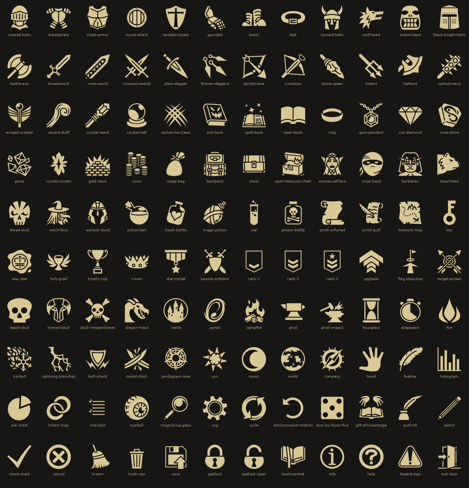

# D2R GUI: what it can do

D2R GUI gives a D2RLoader plugin an in-game window that looks and behaves
like the game's own, without writing any window code. It is the window code
of Grail On! and I Hate TOMLs, made reusable: both plugins now draw
everything through it, and the D2R GUI Demo plugin is built from nothing else.

It is header-only. Include `d2r_gui.h`, and the library compiles into your
plugin's DLL. No extra DLL, no companion D2RMM mod, nothing shared between
plugins at run time.

Version 0.0.1, not released yet. The D2R GUI Demo plugin shows all of it.

---

## A window is a description

The plugin says what is in its window, and binds each part to its own data.
The library does the rest.

```cpp
#include <d2r_gui.h>
#include <d2r_gui/icons.h>
#include <d2r_gui/app.h>
namespace App = D2RGui::App;

bool ShowOdd = true; int Mode = 0, Count = 10; std::string Name;

App::Window window {
    .title = "My Plugin",
    .menus = {
        { .tab = {"scroll-unfurled", "Rules"}, .items = { App::Text("How it works...") } },
        { .tab = {"cog", "Settings"}, .pages = {
            { .tab = {"eyeball", "Display"}, .items = {
                App::Section("Display"),
                App::Check("Show odd rows", &ShowOdd).Tip("Shows or hides them"),
                App::Choice("Mode", &Mode, {"Fast", "Safe"}),
                App::Number("Count", &Count, 0, 99),
                App::Field("Name", &Name, "Type a name") } } } } },
    .console = "myplugin",
    .keybind = "Open My Plugin",
    .changed = [] { SaveSettings(); },
};

// While the plugin loads:
App::Start(context, "my-plugin", std::move(window));
```

That is the whole window. The library lays out the rows, makes the menu and
page tabs, writes the player's changes into the variables, opens the
drop-downs, types into the text boxes, scrolls the page, and behaves like the
game's left panels. It also adds the console command and the key binding.

| Component | What the player gets |
| --- | --- |
| `Section` | A gold title with a rule under it. |
| `Text` | A paragraph, wrapped to the window. |
| `Check` | A check box. |
| `Choice` | A drop-down. A long one scrolls, filters as you type and can have section headers. |
| `Number` | A number between arrows, kept between a minimum and a maximum. |
| `Field` | A text box. |
| `Action` | A button. |
| `List` | Rows with a name and a value, clickable. |
| `Cells` | Item cells that each take one item code, with a text beside each. |
| `Custom` | The plugin's own widgets in a row, for anything else. |

Any component can have a tooltip, a function called when it changes, and a
condition that shows it only when it applies.

Every piece below is also there on its own, for a plugin that draws its own
window.

---

## Windows

| You get | What it does |
| --- | --- |
| **Left panel frame** | The game's left-panel frame, title band and close button. |
| **Character-screen window** | A window drawn like the character screen, using the game's own background art. I Hate TOMLs uses this one. |
| **Stash-look window** | The stash's corners, edges and gold line around dark stone, with a gold title and the game's close button. Charm Inventory uses this one; Grail On!'s window is in the same look. |
| **Behaves like a game left panel** | Opening it closes the character screen, quests, waypoints and stash, and opening one of those closes it. The view shifts right while it is open, as it does for theirs. |
| **Windows that change while open** | A pool of panels takes turns, so every rebuild shows the new layout. Rebuilds are combined into one per frame, and the pool recovers on its own if the game keeps an old layout. |
| **Fast repeat views** | Many panels each keep one view built. A view you saw before opens at once, and the view unused for longest is replaced first. |
| **One-off panels** | A panel with a fixed layout, or one that gets a new layout each time it is shown. |
| **Stays on screen** | Its anchor is written out in full, so a mod that moves `$LeftPanelAnchor` (ESP, for example) can't push the window off screen. |

## Controls

| Control | Notes |
| --- | --- |
| Text | The game's styles (title, label, note, gold, grey…), wrapped to a width, CJK included. |
| Buttons | Sprite buttons with normal, hovered and pressed frames, text buttons, invisible click areas, tooltips, the game's click sounds. |
| Check boxes | Ticked, unticked and greyed out. |
| Text boxes | Real typing: keyboard layouts, Shift, AltGr, copy, paste, undo, select all. A caret while typing, a grey hint while empty. Enter, Esc and click-away each call your code. |
| Drop-downs | The game's own drop-down box and list. Long lists scroll with the wheel and a scroll bar, filter as you type, and can have section headers. |
| Number steppers | A number between two arrows. |
| Scroll bars | A recessed track with a bronze thumb sized to the share shown. Click a step to jump, drag the thumb, or use the mouse wheel over the window. |
| Clip views | Content taller than its room, cut to the room. |
| Section titles, dividers, table rows | For settings pages and long lists. |
| Icon tabs | A row or column of square tabs with an icon each, as Grail On!'s menus: lighter on hover, gold-rimmed when current. |
| Menus and pages | Menus as a row of icon tabs and the current menu's pages under them. Each menu remembers its last page. |
| Inventory button | A button on the inventory's left edge in the stone and gold mold that Charm Inventory uses. You can move it while the game runs. You can also hide it and show it again live. |

## Items

| You get | What it does |
| --- | --- |
| **Item grids of your own** | An item grid bound to one of the plugin's player pages. |
| **Half-cell tiles** | A 1-wide item sits centred in a 2-wide slot, for both drawing and the mouse. |
| **Tooltips past the grid** | An item can show its tooltip on a picture tile outside the grid's own cells. |
| **No "cannot wear" colour** | Items in your grid aren't coloured red, neither by the game nor by Item Quality Backgrounds. |
| **Item cells** | Single cells that each take one item code only, such as an offering of one of each rune. The items stay on the player page, through Player Page Host or the plugin's own page, and can be taken back. The plugin hears when a cell fills or empties. |
| **Item pictures** | Item art recoloured like the game does it, greyed out for items not found yet, with sockets, runes and Item Quality Backgrounds' quality colours. |

## Art

- **The game's own art, at any size.** The library reads drop-down boxes, loot filter rows and arrows, close and refresh buttons, slots, the scroll track and the character screen from the game's files, mods included. It resizes them on demand.
- **Its own drawing when that art is missing.** Every part falls back to art in the game's look, so a window never needs a companion mod.
- **Low-end copies.** Half-size `.lowend` sprites are made for the game's low graphics setting.
- **Your own PNGs.** They are compiled into the DLL's code, with no resources and no Windows image codecs. Antivirus scanners flagged the usual method.
- **Two scaling styles.** Bilinear, as I Hate TOMLs uses, and area average, as Grail On! uses.
- **Picture tools.** Icons from masks, glows, ring charts, gems and gold rules.

## Icons

120 icons from [game-icons.net](https://game-icons.net), at any size and in
any colour: gear, weapons, classes, potions, menus and buttons.

```cpp
#include <d2r_gui/icons.h>

c += Gui::Image("Settings", 40, 40, Gui::Icons::Sprite("cog", 64, {215, 200, 150}));
```



Another of the site's 4000 icons is one line in `tools/gen_icons.py`. The
set is opt-in, so a plugin that doesn't use icons doesn't carry them. The
icons are CC BY 3.0: a plugin that uses them credits them
([ICONS-CREDITS.txt](ICONS-CREDITS.txt)).

## Text and languages

- **Translated strings** in all 13 of the game's languages, named from layouts as `@my-plugin:Key`.
- **Text the game's font can draw.** Characters the font lacks are replaced.
- **The game's real font sizes**, read from the fonts and layout profiles it loads (a font mod's when one is installed). Rows and wrapping fit before the game draws them, and Low Vision Mode is followed.

## Mouse and game screen

- The mouse wheel scrolls the window while the cursor is over it.
- Any other mouse message can go to your plugin first. Middle click is one example.
- The library can tell whether the stash is open, so a window can sit over it like the cube does.
- It hides the life number on the HUD while your window is open, as the game does for its own left panels.

---

## Safe by design

- **Fixed names only.** D2RLoader gives each plugin about 255 widget lookups and never takes them back, so the library looks up only fixed names.
- **Chains with other plugins.** Hooks are added on top of whatever is already there. Inventory Slots wraps the same grid entries.
- **Self-contained.** Each plugin carries its own copy of the library, so two plugins on different library versions never affect each other.

For the full list of headers, see [README.md](README.md).
